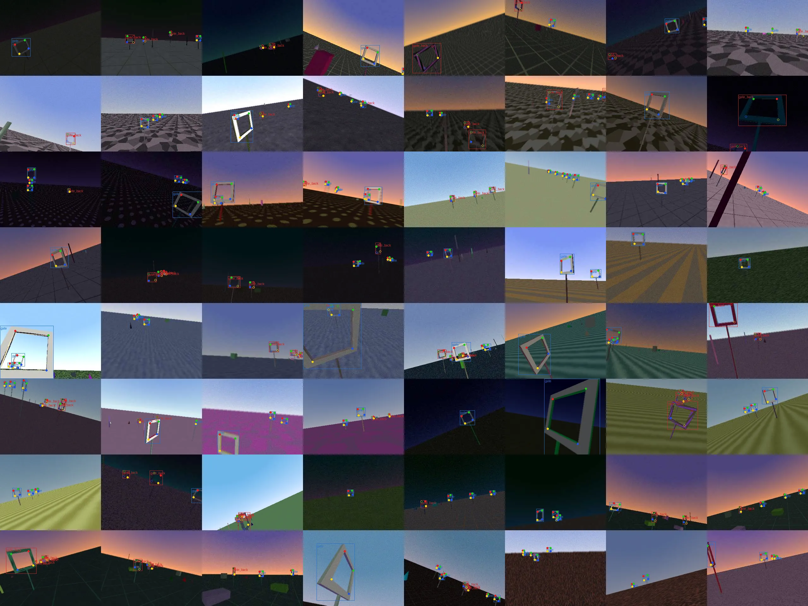

# Kestrel

A camera-only racing drone that a team of AI agents teaches to fly, in simulation, with no human labeling.

The drone has one forward camera and its own motion estimate. It does not know where the gates are. Agents generate synthetic training data, train a gate detector, tune the flight controller, review crash footage, and decide what to try next. Every claim an agent makes is checked by code.

Status: phase 1 (world and labels).

## Rules of the world

These rules define what camera-only means here.

| The pilot knows | The pilot does not know |
| :- | :- |
| Its own position, velocity, attitude (as if from visual inertial odometry) | Where any gate is |
| Onboard camera frames, 320x240, 30 Hz | How many gates there are |
| The physical size of a gate (0.60 m inner square, 0.80 m outer) | The course layout or seed |
| | Which objects are decoys |

The simulator knows everything and uses it only for labels, scoring, and crash cause ground truth. Only `kestrel/sim/oracle.py` may read gate ground truth, and a test asserts that nothing under `kestrel/pilot/` imports it.

## Synthetic labels

Each gate in view gets a box around its outer frame and 4 keypoints on the inner corners of its front face, ordered top left, top right, bottom right, bottom left as seen from the front. Gates seen from behind get a separate class, `gate_back`, so the pilot never aims at the wrong side. Keypoints are marked visible, occluded (blocked on a ray test) or outside the frame.



Keypoint colors on the sheet: top left red, top right green, bottom right blue, bottom left yellow. Hollow keypoints are occluded. Projected keypoints agree with the rendered gate edges to within 0.14 px on 50 random frames, for both renderers (`tests/test_label_projection.py`).

Every frame is drawn with randomized looks from a preset in `configs/dr/`: gate color and pattern, one of 12 ground textures, a day, dusk or night sky, light from any direction, up to 15 poles, boxes and cones, motion blur, sensor noise, exposure and JPEG quality. The ranges in a preset must sit inside hard limits in `kestrel/data/randomize.py`. Gates hidden behind other objects get no label. The sheet above comes from `kestrel data preview`, which reads a written dataset back from disk.

## Development setup

PyBullet has no Windows wheels, so development runs on Linux (WSL Ubuntu on Windows), the same as Kaggle.

```sh
curl -LsSf https://astral.sh/uv/install.sh | sh
uv sync
uv run kestrel sim smoke
uv run pytest
uv run ruff check .
```

When the repo lives on the Windows drive and is used from WSL, keep the virtual environment on the Linux side for speed:

```sh
export UV_PROJECT_ENVIRONMENT=$HOME/.venvs/kestrel
```

## Commands

| Command | What it does |
| :- | :- |
| `kestrel sim smoke` | Hovers the drone at 1 m for 5 s and renders the onboard camera. Fails if the hover error is above 0.10 m |
| `kestrel sim bench --workers N [--egl]` | Measures onboard render throughput in frames per second |
| `kestrel gen --out DIR [--frames 8000] [--dr base]` | Writes a YOLO pose dataset of randomized frames from training courses, with `data.yaml` and `manifest.json` (preset, seeds, counts, git commit, intrinsics). Refuses to overwrite a dataset |
| `kestrel data preview DIR` | Writes a contact sheet of 64 random frames from a dataset, with labels drawn from its label files |
